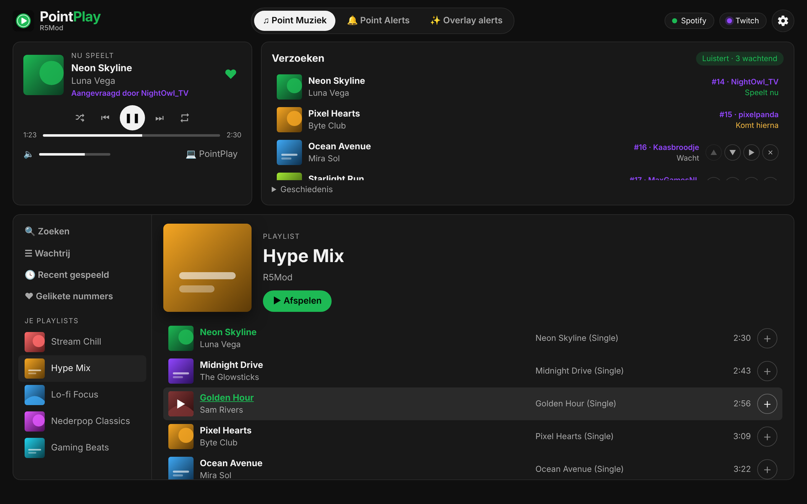
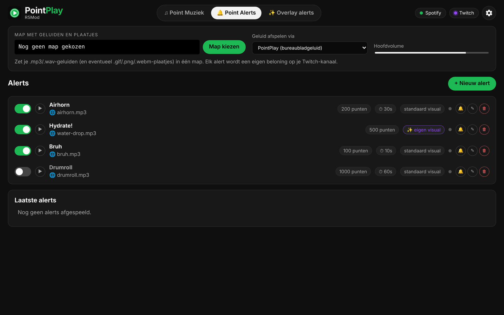
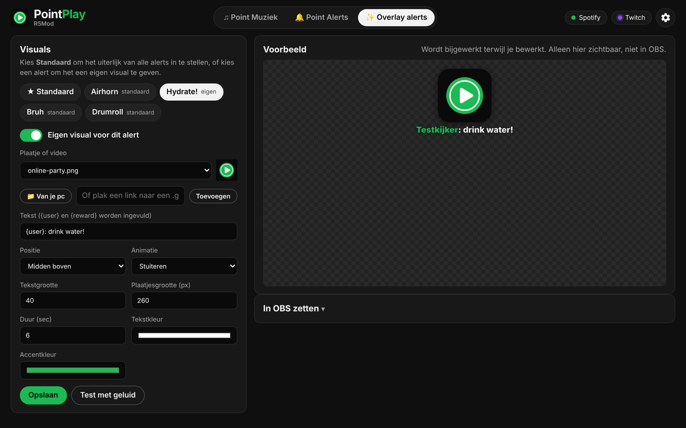
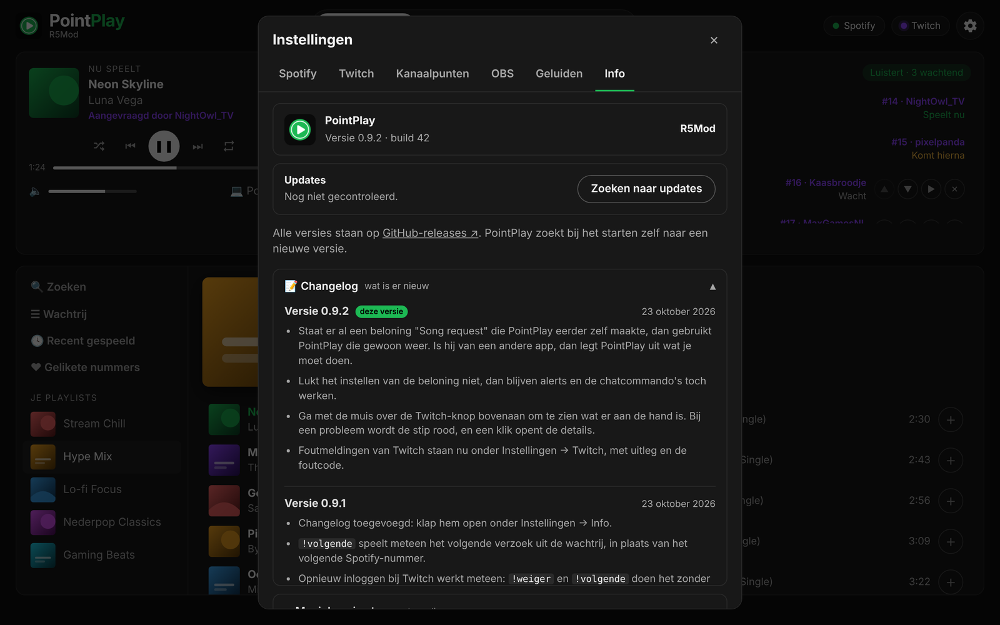

# PointPlay

**Song requests via Twitch-kanaalpunten, rechtstreeks in Spotify.** Plus geluids-alerts en overlay-alerts voor OBS, alles in één Windows-app. Gemaakt door R5Mod.

**[⬇ Download de nieuwste versie](https://github.com/Dave-R5/pointplay-releases/releases/latest)** · [Changelog](CHANGELOG.md)

PointPlay werkt zichzelf bij: nieuwe versies verschijnen vanzelf in de app.

## Point Muziek

Kijkers vragen nummers aan met kanaalpunten. PointPlay zoekt het nummer op, zet het in de wachtrij en speelt het af in de ingebouwde Spotify-speler. Mods kunnen in de chat `!weiger <nummer>` en `!volgende` gebruiken.

## Point Alerts

Laat een geluid afspelen als iemand een beloning inwisselt. Kies geluiden van je pc, zoek ze op Freesound of plak een link.

## Overlay alerts

Een visual voor OBS bij elk alert: één standaard stijl, of per alert een eigen plaatje, tekst en animatie.

## Instellingen en info

Koppel Spotify en Twitch, stel de beloning in en bekijk wat er nieuw is.

## Nodig

- Windows 10 of 11
- Spotify Premium
- Twitch Affiliate of Partner (voor kanaalpunten)

## Disclaimer

PointPlay is een onafhankelijk project en is niet gemaakt, goedgekeurd of ondersteund door Spotify, Twitch of Freesound. PointPlay geeft je geen recht om muziek uit te zenden: jij bent als streamer zelf verantwoordelijk voor wat er op je stream te horen is. Gebruik op eigen risico, zonder garantie.

_Screenshots met voorbeelddata._
